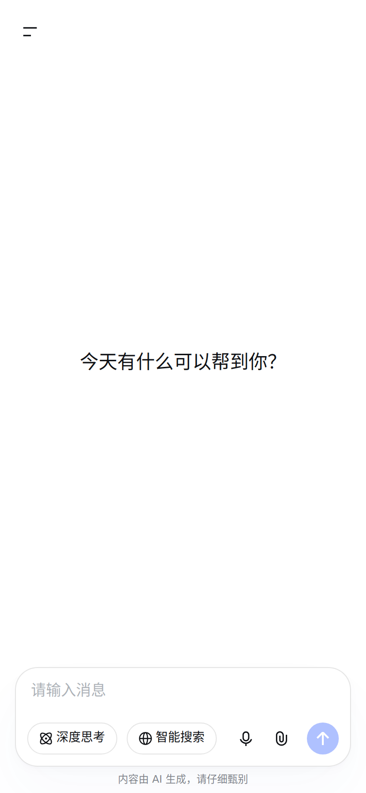

# DeepSeek Chat（非官方安卓客户端）

> **非官方项目**：基于 [deepseek-ai/chat-demo](https://github.com/deepseek-ai/chat-demo)（MIT）修改并打包成 Android App。
> 与 DeepSeek 官方无隶属关系，也未获得官方背书；“DeepSeek”仅用于说明接口兼容性。

把 DeepSeek 官方的静态聊天示例包装成手机应用：保留网页端全部能力，并增加手机端需要的设置和交互。



## 功能

- 流式回答、深度思考、联网搜索与来源引用
- 多会话、消息分支、编辑提问、重新生成
- 图片/文件附件、语音输入、回复朗读
- 自定义接口地址（官方 API 或兼容 Anthropic 接口的中转站）
- 上下文压缩：把较早对话总结成摘要，减少 token
- 删除单条 AI 回复，删除后可重新生成
- 「帮我回一句」：角色扮演时替你写一条回复并填入输入框
- 「让剧情继续」：直接让 AI 往下写剧情
- 自动折叠思考过程（可在设置里开关）
- 自定义用户 / AI 头像，可开关显示
- 应用内「检查更新」：读取本仓库的最新 Release，发现新版本直接打开下载页
- 深浅色主题、中英文界面、历史导入（默认合并，也可选择覆盖）/导出

## 下载与安装

应用内：设置 → 通用设置 → 版本与更新 → 检查更新（读取本仓库的 latest Release）。


在 [Releases](../../releases) 下载 APK。

- Android 8.1 及以上
- 首次安装需允许“安装未知应用”
- 首次打开在“设置 → 数据管理”里填写自己的 API Key
- 覆盖安装请使用同一签名；签名不同的包需要先卸载（会清空本地对话）

## 构建

准备 Node.js 22.12+、pnpm、JDK 17，以及 Android SDK 的 build-tools 与 `android-34` platform：

```sh
pnpm install
pnpm build

# 按自己的 SDK 路径设置；脚本会打包 dist/、生成 APK 并签名
ANDROID_JAR=/path/to/android-34/android.jar \
BUILD_TOOLS=/path/to/build-tools/34.0.0 \
D8_JAR=/path/to/build-tools/34.0.0/lib/d8.jar \
./android/build-apk.sh
```

产物在 `android/build/`。仓库**不包含签名密钥**（`keystore.jks` 已被忽略）；自己构建的 APK 使用你自己的签名，不能覆盖安装本仓库 Release 里的包。

## 数据与隐私

- API Key、设置、对话、附件都只保存在手机本地
- 发送消息、上传附件、语音只请求你自己设置的接口地址（默认 `https://api.deepseek.com`）
- 没有统计、埋点或账号系统

## 许可证

MIT，见 [LICENSE](LICENSE)。原始代码版权归 `Copyright (c) 2026 DeepSeek` 所有；
修改内容与第三方组件说明见 [NOTICE](NOTICE)。
